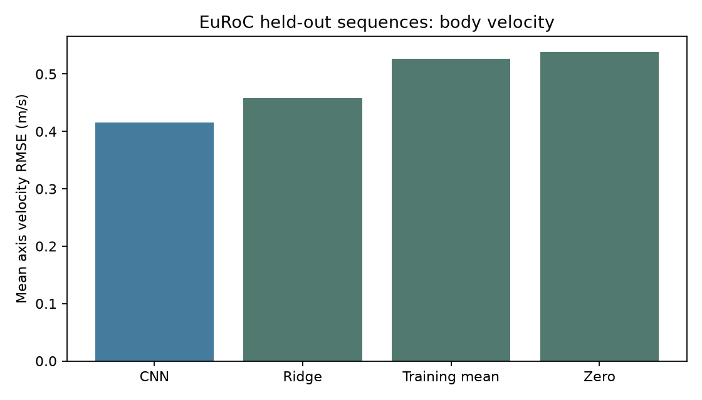

# IMU-only drone odometry: deep velocity learning

A separate research project for **Shreya, Pranjal, Meghna and Ritesh**, built around EuRoC MAV inertial measurements and reference motion. No images or GPS enter the model. The first temporal CNN improves held-out **body-velocity RMSE by 9.2% over Ridge**, but the simple trajectory pipeline still drifts badly and does **not** beat stationary/constant-velocity position baselines. This is a reproducible starting point for IO research, not a production navigation system.



## What is implemented

- Pinned, checksum-verified download of the ~19 MB EuRoC IMU/reference subset packaged by AirIO; no large image download.
- Integer-safe timestamp alignment, quaternion SLERP, reference coverage checks, and causal one-second windows that reset across gaps.
- Six raw gyro/accelerometer channels plus elapsed sample time as inputs; reference body-frame velocity as supervision only.
- A small PyTorch temporal CNN, training-only normalization, validation early stopping, and saved checkpoint.
- Matched-sample zero/mean/Ridge baselines, per-sequence held-out metrics, raw inertial integration and learned-velocity trajectory evaluation.
- Tests, CI, plots, run metadata, dataset audit and a four-person work plan.

## Measured first run

Macro mean axis velocity RMSE, averaged equally across held-out MH_05_difficult and V2_03_difficult:

| Method | RMSE (m/s) ↓ |
|---|---:|
| Temporal CNN | **0.4157** |
| Ridge | 0.4578 |
| Training mean | 0.5262 |
| Zero velocity | 0.5388 |

The CNN was selected on validation before evaluating these test sequences. Its gain is 9.2% versus Ridge and 22.8% versus zero velocity on this protocol, **not versus the old PX4–GPS residual project**. One seed and two sequences are insufficient to establish generalization. See [first-run report](results/first_run/REPORT.md).

For position, CNN trajectory RMSE is **16.36 m / 7.28 m** on the two sequences, worse than zero velocity (**8.11 m / 2.15 m**). Raw uncalibrated IMU integration fails severely; beating that weak baseline is not proof of reliable odometry. Bias/orientation handling is the next major problem.

## Run locally

Python 3.10+; the first run used Python 3.12 on CPU. From this directory:

```bash
python3 -m venv .venv
source .venv/bin/activate
pip install -e .
python -m unittest discover -s tests -v
python scripts/download_data.py
python scripts/prepare.py
```

Evaluate the saved first-run model and regenerate plots:

```bash
python scripts/evaluate.py
python scripts/plot_results.py
```

For a **new training run**, preserve the original results in a different directory:

```bash
python scripts/train.py --output results/my_run
python scripts/evaluate.py --output results/my_run
python scripts/plot_results.py --output results/my_run
```

`configs/euroc.json` fixes sequence splits, seed, windows and training settings. Data and virtual environments are ignored by Git. Prepared-array content hashes guard against silent dataset changes. The exact first-run environment is saved in `results/first_run/environment-lock.txt`; install it in a separate environment if exact dependency versions are needed. Local dataset download/preparation is required even though the small trained checkpoint and metrics are included.

Predict from a raw IMU CSV without loading any reference file:

```bash
python scripts/predict.py data/euroc/MH_05_difficult/mav0/imu0/data.csv --output results/predictions.csv
```

The CSV uses timestamp in nanoseconds followed by gyro xyz and specific-force xyz. Output is body velocity, not position; full trajectory inference additionally requires an initialization/orientation strategy.

## What “IMU-only” means here

The velocity network receives no reference orientation, velocity, bias, position, GPS, or images. Reference orientation is used offline to construct body-velocity labels. The trajectory experiment is **reference-initialized once per continuous segment** with position/orientation and initial velocity for classical integration; it is not unaided startup. After that, orientation is propagated using raw gyroscope measurements only. No ongoing reference attitude, reference bias, or trajectory alignment is used. A camera or GPS is not needed for model inference.

The project does not yet implement a bias-aware filter, robust orientation initialization, sensor acquisition or a deployment-ready streaming navigator. Evaluating a public dataset does not prove real-flight reliability. Read [methodology and limitations](docs/METHODOLOGY.md) before interpreting position errors.

## Team ownership

| Member | Assigned workstream |
|---|---|
| Meghna | Dataset provenance, quality audit, reference alignment and split review |
| Pranjal | Data windows, inertial integration, initialization and inference pipeline |
| Shreya | Deep model, training, validation and model ablations |
| Ritesh | Independent evaluation, baselines, trajectory metrics, plots and report |

These are assignments for team review and future contributions, not a claim that each member authored the initial scaffold. See [deliverables and next four workdays](docs/TEAM_PLAN.md). The initial scaffold was generated with Codex at Shreya's request; commits use actual timestamps and configured authorship.

## Dataset choice and sources

EuRoC is a suitable first drone benchmark, not a perfect or large-scale training corpus. V1_01 is excluded because of known orientation-reference issues. Splits are project-specific, not an official learning benchmark. Reference states have measurement/estimation limitations, and held-out sequences share environments with training.

- [EuRoC original dataset, calibration and paper](https://projects.asl.ethz.ch/datasets/euroc-mav/)
- [AirIO dataset packaging and drone IO baseline](https://github.com/Air-IO/Air-IO)
- [Blackbird UAV: possible future IO expansion](https://github.com/mit-aera/Blackbird-Dataset)
- [Dataset details and provenance](docs/DATASET.md)

This project independently implements its CNN; it does not reproduce AirIO's architecture or claim its published results. Raw datasets retain their original terms and are not committed. See [third-party acknowledgements](THIRD_PARTY.md).
